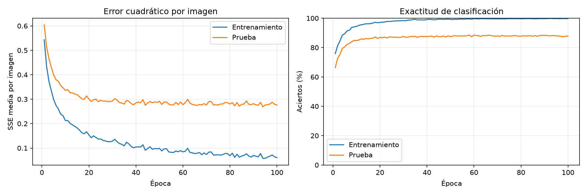

# Taller de redes neuronales feedforward: MNIST desde cero

Desarrollo del [taller de Diego R. Ibarra](https://github.com/DiegoRIbarra/TallerSaid), basado en la guía de la revisión `221534001cd5fd6e6e6d2f9ff197db7479d27c0f`.

## Trabajo realizado

Se construyó una red neuronal con Python y NumPy para reconocer dígitos manuscritos del 0 al 9. Se cargaron los archivos MNIST, se transformaron las imágenes de 28 × 28 píxeles en vectores de 784 entradas, se normalizaron sus intensidades a [0, 1] y se codificaron las etiquetas con vectores one-hot.

La red utiliza 100 neuronas ocultas con activación ReLU, dropout con probabilidad de conservación de 0.5 y diez salidas lineales. Se implementaron explícitamente la propagación hacia adelante, la retropropagación y las actualizaciones de pesos mediante descenso de gradiente. La predicción corresponde al índice de la mayor puntuación; las salidas no representan probabilidades.

El entrenamiento se realizó durante 100 épocas con las primeras 1,000 imágenes del conjunto de entrenamiento, tasa de aprendizaje 0.005 y semilla 1. La evaluación se efectuó sobre las 10,000 imágenes de prueba. El notebook incluye la visualización de ejemplos, las curvas de aprendizaje, inferencia sobre imágenes de prueba, una matriz de confusión y las respuestas de evaluación.

## Resultados obtenidos

| Medida al finalizar la época 100 | Resultado |
| --- | --- |
| Exactitud de entrenamiento, sin dropout | 99.80 % |
| Exactitud de prueba, sin dropout | 87.82 % |
| Aciertos de prueba | 8,782 de 10,000 |
| SSE media por imagen de entrenamiento | 0.0611 |
| SSE media por imagen de prueba | 0.2763 |

El error de prueba descendió de 0.6042 en la primera época a 0.2763 en la última. Las curvas muestran que el rendimiento sobre los ejemplos de entrenamiento continúa mejorando mientras la exactitud de prueba se estabiliza alrededor de 88 %. La brecha final de 11.98 puntos porcentuales indica que persiste una diferencia entre memorizar los ejemplos disponibles y generalizar a imágenes nuevas.

La matriz de confusión permite revisar errores concretos: por ejemplo, 95 imágenes del dígito 4 se clasificaron como 9 y 87 imágenes del 3 se clasificaron como 5. Estos resultados corresponden a esta ejecución y no garantizan el mismo comportamiento con fotografías o dibujos externos.



## Archivos

- `taller_fnn_mnist.ipynb`: notebook ejecutado, con explicaciones, salidas, gráficas y preguntas respondidas.
- `requirements.txt`: dependencias para abrir y ejecutar la práctica.
- `resultados/historial.csv`: error y exactitud de entrenamiento y prueba en las 100 épocas.
- `resultados/metricas.json`: métricas finales, hiperparámetros y versiones del entorno utilizado.
- `resultados/pesos_fnn.npz`: matrices de pesos entrenadas.
- `resultados/*.png`: muestras, curvas de aprendizaje, predicciones y matriz de confusión.
- `resultados/matriz_confusion.csv`: conteos por clase real y clase predicha; filas y columnas siguen el orden 0–9, sin encabezado.
- `datos/`: descarga local de MNIST, excluida de Git por su tamaño y porque puede regenerarse.

## Cómo ejecutarlo

Desde esta carpeta, con Python 3.10 o posterior:

```bash
python3 -m venv .venv
source .venv/bin/activate
python -m pip install -r requirements.txt
OPENBLAS_NUM_THREADS=1 OMP_NUM_THREADS=1 jupyter notebook taller_fnn_mnist.ipynb
```

Selecciona el kernel del entorno y ejecuta todas las celdas en orden. La primera ejecución necesita acceso a Internet para descargar MNIST; las siguientes reutilizan los archivos locales. El notebook ya contiene sus salidas, de modo que puede consultarse sin volver a entrenar. Los archivos de `resultados/` se regeneran al ejecutarlo.

Para clasificar una imagen propia, agrega el archivo a esta carpeta y usa la función `clasificar_imagen_propia` de la sección 8. Esa prueba se deja como opcional: no se proporcionó un dibujo personal del alumno. Las pruebas con imágenes de MNIST sí están ejecutadas.
